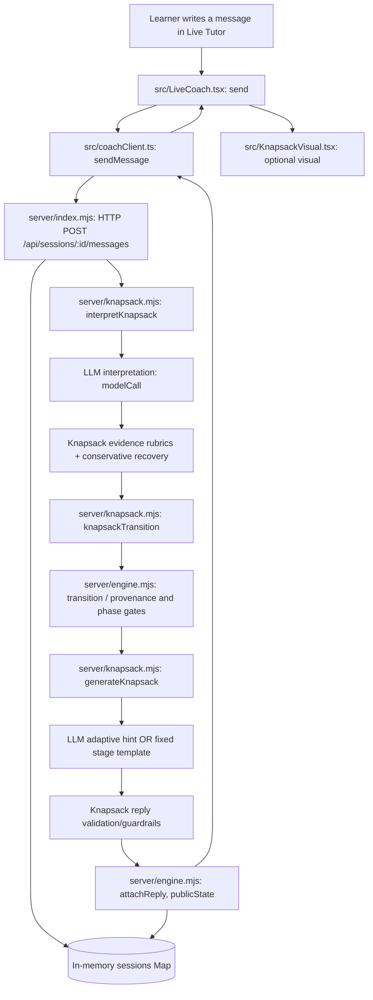

# Report Step 1 — implementation evidence, not a fabricated report

Use these **verified code locations** and inspect the installed final code before submitting.

## One actual learner message walk-through (Pilot 01, learner turn 1)

- The learner entered: `First, I would calculate the value-to-weight ratio for each item...` and explained selecting A then B for a total value of 160.
- `src/LiveCoach.tsx::send()` passed the text to `src/coachClient.ts::sendMessage()`.
- `server/index.mjs` read the session from the in-memory Map, selected `interpretKnapsack()` because the session's `problem` was `zero-one-knapsack`, and recorded safe request diagnostics.
- `server/knapsack.mjs::interpretKnapsack()` requested an evidence assessment from a model. The output included `approach_explained`, quoting the learner's ratio rule. Knapsack's normalization/recovery validates the candidate. The controller is not driven by a mastery-confidence number.
- `server/knapsack.mjs::knapsackTransition()` and the shared controller's `transition()` progressed `approach → gap` and chose action `CHALLENGE`; the accepted quote was recorded with turn provenance.
- `server/knapsack.mjs::generateKnapsack()` generated an LLM reply asking whether another combination involving item C could beat the ratio-greedy selection, without revealing the full optimal algorithm. The reply passed the validator.
- `server/engine.mjs::attachReply()` appended the tutor message and events; `publicState()` provided the updated session to the client; React displayed the tutor reply.
- The actual transcript contains the model call metadata, `policy_decision`, and `coach_reply.source=llm`. Inspect `knapsack-pilot-01.json` for evidence.

## What the working prototype includes

- A real, multi-turn model-backed conversation interface; one problem at a time, not a static script.
- Problem-specific LLM interpretation and evidence recovery; fixed five-checkpoint state machine with current-turn evidence and traceable stored evidence.
- Adaptive clarifications, questions, counterexamples, partial visualisations, support escalation, and mismatch repair; selected actions and phase changes are controller-owned.
- Learner-generated abstraction and a near-transfer prompt (0/1 Knapsack → Partition Equal Subset Sum); Longest Common Substring retained as a previous problem example.
- Evaluation GUI with blind manual labels, transcript import, and judge verdict reveal after labels.

## Deliberate omissions and trade-offs (verify against Assignment 1 spec)

- No broad LeetCode catalogue, automated compiler, general syntax execution engine, persistent learner history, user login, or rich semantic knowledge graph: preserves scope and auditability but limits generality and long-term personalization.
- No robust, validated longitudinal learner mastery estimate: evidence checkpoints indicate what the learner said, **not** mastery or retention.
- No live human study is required by Assignment 2; only a study design.
- Stage-specific transfer and completion prompts are controller-owned, reducing inappropriate questions but also limiting conversational variability.

## Changes since Assignment 1 and feedback

- Initial A1 demo was scripted; A2 implements a live interpreter/controller/generator with genuine learner turns.
- Progression uses quote-grounded observable evidence rather than an opaque mastery score, addressing feedback on demonstrable reasoning.
- Added `repairFocus`/clarification for common grounding, plus a limited learner state and guidance escalation.
- Fixed false-negative progression and inappropriate generation using regression evidence; the controller does **not** preload future-stage evidence or skip milestones.
- Added optional Knapsack problem with an alternative correct exhaustive solution and a subset-sum transfer to check generalisation beyond substring alignment.

**Before submitting:** Confirm this matches the code at your final commit. Cite actual file paths and commit hashes in your report, and explain omitted features in your own words.
